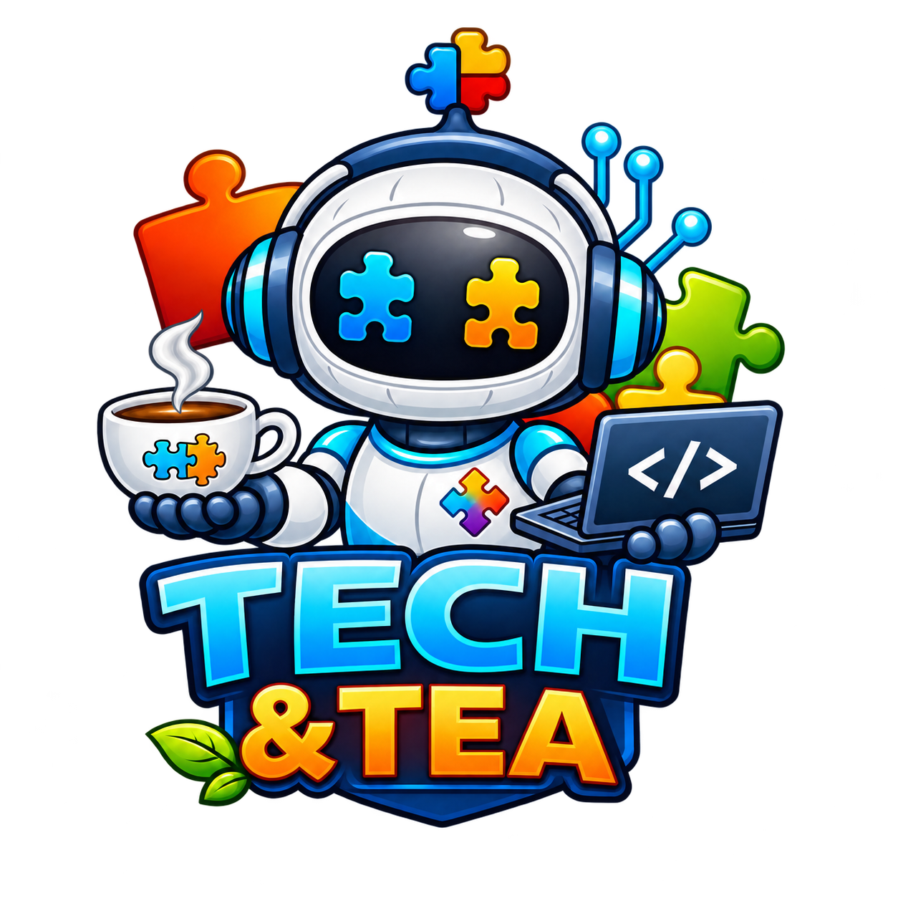

<h1 align="center">Tech & TEA</h1>

  <strong>Neuroinclusive AI Agent for Planning, Productivity and Time Management</strong>

  

O **Tech & TEA** é um agente de inteligência artificial especializado em planejamento, produtividade e gestão do tempo, fundamentado em pensamento computacional, metodologias de aprendizagem e neurociência cognitiva, com abordagem de design neuroinclusivo.

O agente tem como objetivo transformar demandas em planos de execução estruturados, mensuráveis e gerenciáveis, auxiliando o usuário na organização, priorização e execução de atividades.

## Experimente o Tech & TEA

O agente será disponibilizado na plataforma *Dify* para utilização por meio de uma interface conversacional.

**Acesso:** em breve.

## Origem e motivação

O agente Tech & TEA foi originalmente desenvolvido em contexto corporativo, a partir da observação de oportunidades de otimização do processo de planejamento de sprints, especialmente na **estimativa de esforço**, **estruturação das etapas de desenvolvimento** e **gestão do tempo**.

Alinhada à cultura *AI First*, a concepção do agente partiu da premissa de utilizar a inteligência artificial como instrumento de ampliação das capacidades humanas (*Human Augmentation*) e externalização cognitiva (*Cognitive Offloading*), reduzindo o esforço cognitivo associado às atividades de planejamento e organização, de modo a favorecer o direcionamento desses recursos à análise técnica, à tomada de decisões e à resolução de problemas.

Sua construção envolveu a plataforma *StackSpot AI*, engenharia de prompts, criação de *knowledge sources* especializados, estruturação de *knowledge objects* em YAML e Markdown e elaboração de *system prompts* fundamentados em conhecimentos multidisciplinares, regras comportamentais e protocolos operacionais.

A versão atual é reconstruída de maneira independente do *StackSpot AI*, preservando sua identidade e princípios de funcionamento, ampliando seus contextos de aplicação e explorando uma arquitetura modular e portável.

## Problema de negócio

A gestão de tarefas envolve a definição de escopo, estimativa de esforço, priorização de demandas, organização das etapas de execução e distribuição do tempo disponível. Especialmente no desenvolvimento de software, conciliar esses elementos pode ser desafiador diante de atividades simultâneas, requisitos ambíguos, dependências, lacunas de conhecimento, mudanças de prioridade, demandas não planejadas e impedimentos identificados durante a execução.

Um planejamento pouco estruturado pode comprometer a previsibilidade das entregas, a gestão do tempo e a manutenção do foco, além de aumentar a carga cognitiva associada à organização e à tomada de decisões.

O agente propõe uma abordagem estruturada para a gestão dessas atividades, combinando conhecimentos especializados e protocolos operacionais para ampliar a previsibilidade e apoiar a definição de escopo, decomposição de tarefas, estimativa de esforço e elaboração de planos de execução compatíveis com o tempo e a capacidade disponíveis.

## Knowledge Architecture

A arquitetura de conhecimento do Tech & TEA é fundamentada em princípios de *Knowledge Engineering* e *Knowledge Representation*, considerando a aquisição, organização, estruturação e aplicação de conhecimentos especializados.

Está organizada em três categorias:

- **Declarative Knowledge:** conceitos, fundamentos teóricos e princípios metodológicos.
- **Procedural Knowledge:** métodos, procedimentos e protocolos de aplicação do conhecimento.
- **Conditional Knowledge:** condições, critérios e contextos que orientam a seleção e a aplicação dos procedimentos.

Essa distinção permite estruturar a base de conhecimento não apenas como fonte de informação, mas como fundamento para a tomada de decisões, a definição de regras comportamentais e a elaboração de protocolos operacionais.

### Knowledge Sources

A base de conhecimento está organizada em quatro domínios especializados: **metodologias de aprendizagem**, **pensamento computacional**, **neurociência cognitiva** e **produtividade e gestão do tempo**.

A seleção desses domínios considera a complementaridade entre a aquisição de conhecimento, a resolução sistemática de problemas, o processamento cognitivo e a gestão das atividades.

---

#### Por que metodologias de aprendizagem

A incorporação de metodologias de aprendizagem ativa, aprendizagem orientada a resultados e estratégias metacognitivas permite ao agente estruturar a aquisição de conhecimento como parte do processo de resolução de problemas, considerando a identificação de lacunas conceituais, a definição de objetivos de aprendizagem, a progressão do domínio e a avaliação da compreensão.

Cada metodologia desempenha uma função específica nessa abordagem:

- **Problem-Based Learning (PBL):** fundamenta a aprendizagem ativa e contextualizada, utilizando o problema como elemento estruturante da investigação, da aquisição de conhecimento e da aplicação prática.
- **Outcome-Based Learning (OBL):** estabelece uma abordagem orientada a resultados observáveis e mensuráveis, alinhando os objetivos de aprendizagem aos critérios de desempenho e domínio esperados.
- **Técnica Feynman:** utiliza a autoexplicação e a elaboração conceitual como estratégias metacognitivas para identificar lacunas de conhecimento, verificar a compreensão e consolidar modelos mentais.
- **Mapas mentais:** utilizam a representação visual e a organização associativa do conhecimento para estruturar informações, explicitar relações conceituais e favorecer a compreensão.

A integração dessas metodologias fundamenta protocolos operacionais de aprendizagem contextualizada, autorregulação da aprendizagem, monitoramento metacognitivo, resolução incremental de problemas e validação do conhecimento adquirido.

No agente, essa abordagem permite incorporar as necessidades de aprendizagem à decomposição das tarefas, à estimativa de esforço e ao planejamento temporal, estabelecendo objetivos de aprendizagem, níveis de aprofundamento e critérios de domínio compatíveis com os requisitos da atividade.

---

#### Por que pensamento computacional

A incorporação de princípios do pensamento computacional permite ao agente aplicar uma abordagem sistemática à formulação, análise e resolução de problemas, utilizando conceitos fundamentais da **Ciência da Computação** para transformar demandas complexas em estruturas lógicas, organizadas e executáveis, independentemente do domínio de aplicação.

Os quatro pilares do pensamento computacional desempenham funções complementares nesse processo:

- **Decomposição:** permite dividir um problema em subproblemas e unidades de trabalho gerenciáveis, reduzindo a complexidade da análise e possibilitando a identificação de responsabilidades, dependências e pré-requisitos.
- **Reconhecimento de padrões:** permite identificar similaridades, recorrências e estruturas comuns entre problemas, favorecendo a reutilização de estratégias de resolução e conhecimentos previamente adquiridos.
- **Abstração:** permite representar os elementos essenciais de um problema, selecionando informações relevantes e desconsiderando detalhes que não interferem em sua resolução, contribuindo para a delimitação de escopo e o controle da complexidade.
- **Pensamento algorítmico:** permite estruturar estratégias de resolução em sequências lógicas de operações, considerando condições, dependências, ordenação e critérios de conclusão.

Esses princípios são complementados por conceitos de modularidade, hierarquização, granularidade e resolução incremental, que fundamentam a organização das atividades em unidades com responsabilidades delimitadas, passíveis de análise, execução e validação individual.

No agente, essa abordagem permite estabelecer uma estrutura lógica de trabalho que fundamenta a priorização das atividades, a identificação de dependências, a estimativa de esforço e o planejamento temporal. A decomposição em unidades de trabalho com granularidade adequada possibilita avaliar o esforço necessário em cada etapa e organizar sua execução de acordo com os objetivos, as restrições e a capacidade disponível.

---

#### Por que neurociência cognitiva

A incorporação de conhecimentos da neurociência cognitiva e da psicologia cognitiva fundamenta o design comportamental do agente a partir da compreensão dos processos mentais envolvidos na aprendizagem, no planejamento, na tomada de decisões, no tratamento de informações e na execução de atividades.

Essa compreensão orienta o desenvolvimento de interações acessíveis, respeitando a diversidade dos perfis de processamento de informações e buscando reduzir barreiras relacionadas à interpretação, organização e execução de atividades.

Entre os principais conceitos que fundamentam essa abordagem, destacam-se:

- **Funções executivas:** fundamentam estratégias de apoio ao planejamento, à organização, à iniciação de tarefas, à priorização e ao monitoramento do comportamento orientado a objetivos.
- **Memória de trabalho:** justifica a externalização e a estruturação das informações, reduzindo a necessidade de manutenção e manipulação simultânea de múltiplos elementos durante a execução de atividades.
- **Carga cognitiva:** orienta a segmentação de atividades, a adequação da granularidade das informações e a redução da carga extrínseca associada à sua apresentação e organização inadequadas.
- **Regulação atencional:** orienta estratégias de direcionamento, sustentação e alternância do foco atencional, considerando os objetivos estabelecidos e os estímulos concorrentes.
- **Controle inibitório:** subsidia mecanismos de controle de escopo, gerenciamento de distrações e redirecionamento de atividades que não contribuem para o objetivo estabelecido.
- **Flexibilidade cognitiva:** orienta estratégias de adaptação e replanejamento diante de mudanças de contexto, requisitos, prioridades e impedimentos.
- **Hiperfoco:** orienta estratégias que favoreçam o aproveitamento da concentração intensa, considerando possíveis dificuldades relacionadas à percepção temporal, à alternância entre atividades e ao controle de escopo.
- **Metacognição:** fundamenta estratégias de monitoramento, avaliação e autorregulação dos processos de aprendizagem e resolução de problemas.

A cognição autista constitui uma referência fundamental para a concepção do agente, considerando tanto as particularidades do processamento de informações quanto as potencialidades associadas à sistematização, ao reconhecimento de padrões, à precisão e à organização lógica. Essa abordagem reconhece a heterogeneidade dos perfis autistas e incorpora suas características ao planejamento e à estruturação das interações, sem restringir sua aplicação a pessoas neurodivergentes.

A integração desses conhecimentos orienta o design comportamental do agente segundo as diretrizes de *Cognitive Accessibility*, *Neuroinclusive Design* e *Executive Function Support*, traduzidas nas seguintes características:

- Redução da ambiguidade;
- Comunicação explícita;
- Estruturação lógica, hierárquica e sequencial;
- Previsibilidade;
- Controle de escopo;
- Manutenção e redirecionamento do foco;
- Resolução incremental de problemas;
- Definição de objetivos observáveis e mensuráveis;
- Estabelecimento de critérios explícitos de início e conclusão;
- Organização visual das informações;

No agente, essa abordagem fundamenta a definição de regras comportamentais, protocolos operacionais e estratégias de interação que consideram diferentes necessidades individuais. A acessibilidade cognitiva é incorporada transversalmente ao planejamento, à decomposição de problemas, à gestão do tempo e à aprendizagem, constituindo um princípio fundamental da concepção do agente, e não uma funcionalidade complementar.

> **Human-Centered AI (HCAI)**
>
> Essa fundamentação aproxima o Tech & TEA dos princípios de *Human-Centered AI*, incorporando a dimensão humana à concepção do agente. A eficiência operacional não é tratada de maneira dissociada das capacidades, necessidades e particularidades do indivíduo. O planejamento, portanto, não considera apenas o trabalho a ser realizado, mas também o funcionamento cognitivo de quem o executa, conciliando produtividade, acessibilidade cognitiva, autonomia e sustentabilidade do esforço mental.

---

#### Por que produtividade e gestão do tempo

A incorporação de metodologias de produtividade e gestão do tempo permite ao agente integrar o planejamento estratégico das atividades à organização operacional de sua execução, considerando a relação entre objetivos, prioridades, esforço necessário, capacidade disponível e restrições temporais.

Enquanto o pensamento computacional fundamenta a **estruturação lógica da resolução de problemas**, a gestão do tempo estabelece as condições para sua **viabilidade operacional**.

Cada abordagem desempenha uma função específica nesse processo:

- **SMART:** estabelece critérios para a definição de objetivos específicos, mensuráveis, atingíveis, relevantes e temporalmente delimitados, auxiliando na definição de escopo e na avaliação dos resultados.
- **Deep Work:** fundamenta a organização de períodos de concentração sustentada para atividades cognitivamente exigentes, considerando a redução de interrupções, a fragmentação da atenção e os custos associados à alternância de contexto.
- **Pomodoro:** utiliza intervalos estruturados de concentração e descanso como estratégia de organização temporal, manutenção do foco e autorregulação durante a execução das atividades.
- **Time Blocking:** utiliza a alocação planejada de blocos temporais para organizar atividades, estabelecer prioridades e distribuir o trabalho de acordo com a disponibilidade efetiva.

Essas metodologias são complementadas por conceitos fundamentais de planejamento e gestão de atividades:

- **Priorização:** define a importância relativa das atividades considerando relevância, urgência e impacto.
- **Estimativa de esforço:** dimensiona a quantidade de trabalho necessária à execução de uma atividade, considerando sua complexidade, os conhecimentos requeridos, as dependências e as incertezas envolvidas, distinguindo o esforço necessário da duração efetiva da atividade.
- **Planejamento de capacidade:** estabelece a compatibilidade entre o volume de trabalho previsto e os recursos efetivamente disponíveis.
- **Alocação temporal:** distribui as atividades ao longo do tempo, considerando esforço estimado, prioridades, dependências e restrições.
- **Monitoramento e replanejamento:** fundamentam a revisão das estimativas e a reorganização das atividades diante de desvios, impedimentos e mudanças de contexto.

A integração desses conhecimentos fundamenta protocolos operacionais de definição de objetivos, dimensionamento do trabalho, gerenciamento de prioridades, organização temporal, controle de escopo e acompanhamento da execução.

No agente, essa abordagem permite transformar a estrutura lógica obtida por meio do pensamento computacional em um plano de execução operacionalmente viável, incorporando as necessidades de aprendizagem e os princípios de acessibilidade cognitiva ao planejamento. A produtividade, portanto, não é tratada exclusivamente como maximização do volume de trabalho, mas como a utilização eficiente e sustentável do tempo e dos recursos disponíveis para alcançar os resultados estabelecidos.

## 🎨 Identidade visual

A identidade visual do Tech & TEA foi desenvolvida como uma representação simbólica dos princípios que fundamentam o agente, integrando tecnologia, cognição autista e a dimensão humana da produtividade.

O nome estabelece uma associação semântica entre *Tech*, referência à tecnologia, e *TEA*, que assume um duplo significado: a sigla para Transtorno do Espectro Autista e a palavra inglesa *tea* (chá), associada à pausa, à concentração e ao equilíbrio.

A representação do agente por meio de um robô estabelece sua conexão com a inteligência artificial, enquanto o notebook e os circuitos eletrônicos remetem à computação e ao desenvolvimento de software. As peças de quebra-cabeça incorporam uma dupla representação: a referência histórica à simbologia do autismo e os princípios de decomposição, organização e integração que fundamentam o pensamento computacional.

A composição visual sintetiza, portanto, a proposta do Tech & TEA: integrar tecnologia e compreensão do funcionamento da mente humana para promover uma abordagem de produtividade fundamentada em acessibilidade, organização e equilíbrio.

## 💬 Feedback

O Tech & TEA é um projeto em evolução contínua. Sugestões, observações e experiências de utilização são bem-vindas e contribuem para o aprimoramento do agente.

Identificou algum comportamento inesperado, uma oportunidade de melhoria ou possui sugestões relacionadas à acessibilidade cognitiva, metodologias incorporadas ou experiência de interação?

Compartilhe seu feedback por meio das [Issues](/../../../issues) deste repositório ou entre em contato pelo [LinkedIn](https://www.linkedin.com/in/natalia-fernandes-oliveira).